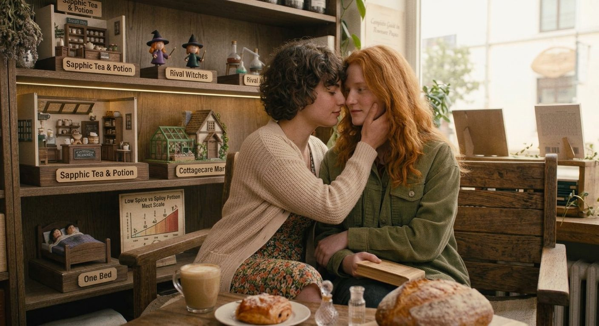

# Fake Dating, Real Feelings: Why This Lesbian Romance Trope Never Gets Old

A fake relationship begins as a practical solution. Bring a date to a wedding. Convince a difficult family member that you have moved on. Protect a job, a public image, a housing arrangement, or a fragile plan. The rules are supposed to be clear: act convincing, avoid real feelings, and end the arrangement when the problem is solved.

Of course, the rules are the point. Fake dating is a romance trope built on the gap between performance and truth. Two women begin by pretending to know each other intimately, and the act of pretending creates the conditions for genuine intimacy.

## Why the trope works

Fake dating gives the characters permission to do things they might otherwise avoid. They hold hands in public, learn details about each other’s lives, attend family events, share hotel rooms, practice affectionate gestures, and defend each other when someone crosses a line. The relationship may be fictional at first, but the care required to sell it often is not.

The trope also creates delicious asymmetry. One character may believe she is acting while the other is already falling. Both may think they are the only one taking the arrangement too seriously. The reader gets to watch them interpret the same moment in two completely different ways.

## Why it resonates in lesbian romance

In sapphic stories, fake dating can gently explore visibility. What does it feel like to present a relationship to family, colleagues, friends, or a community before either woman has fully admitted what she wants? What changes when the performance feels unexpectedly right? These questions can add emotional depth without making the trope solely about coming out.

It can also be joyful. There is pleasure in watching two women discover that the affection they perform in public is easier than the honesty they have avoided in private. The pretend relationship becomes a rehearsal for the real one.

## The best fake dating setups

The strongest setups give both characters a reason to agree and enough shared contact for the lie to become complicated. Weddings work because romance is already in the air. Workplace events create public pressure. Family holidays force characters into intimate domestic spaces. Travel and shared accommodation add proximity. Celebrity or public-facing stories raise the cost of being caught.

## What keeps it from feeling contrived

A fake dating romance needs rules that make sense. Why do these two people need to pretend specifically with each other? What do they risk if the arrangement fails? And, crucially, why do they keep choosing one another once the original reason begins to disappear? The answer should be emotional, not merely logistical.

## Choose fake dating when…

Choose fake dating if you enjoy public displays of affection, private panic, family gatherings, “we are only pretending” dialogue, and the moment when one character realizes she is no longer acting. It is especially satisfying for readers who want romantic comedy energy alongside real emotional stakes.

## Skip it when…

Skip it if deception is likely to make you anxious or if you prefer romance where the characters communicate honestly from the start. Fake dating depends on secrets, even when those secrets are meant to be lighthearted.

The trope remains popular because it asks a universal romantic question: if you had permission to love someone openly for just one day, would you discover that you wanted to keep doing it?

**Keep reading:** Use the [Lesbian Romance Tropes hub](https://lesbianromancereads.com/tropes/) to find fake dating and other sapphic relationship dynamics, or go straight to these [sapphic fake dating romance books](https://lesbianromancereads.com/sapphic-fake-dating-romance-books/).

[← All trope guides](./)
